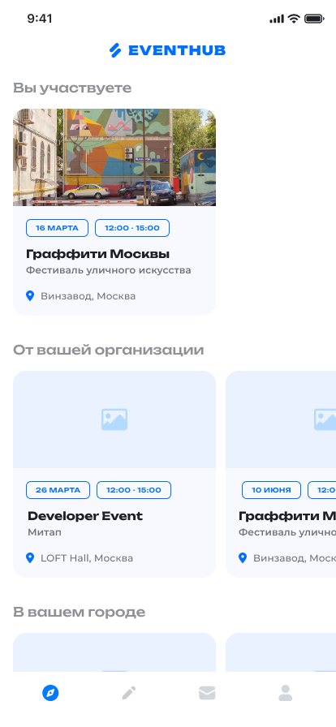
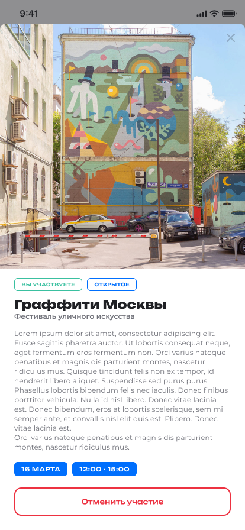
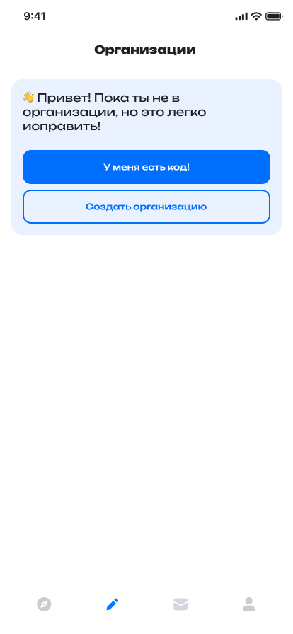
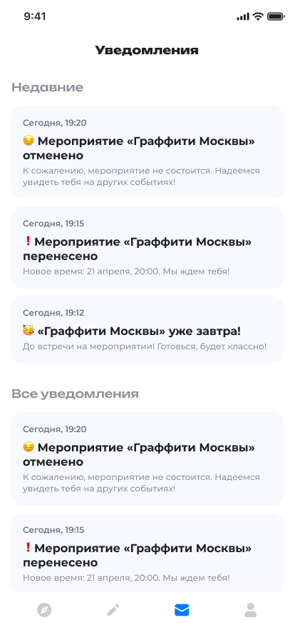

# EventHub

EventHub — приложение для поиска и совместного посещения мероприятий. Пользователь может находить интересные события, вступать в них, следить за уведомлениями и объединяться с участниками в организациях по интересам.

## Что умеет приложение

- регистрация и вход в аккаунт;
- просмотр списка доступных мероприятий;
- поиск событий по названию и содержанию;
- просмотр подробностей мероприятия и списка участников;
- присоединение к мероприятию и выход из него;
- создание организаций и вступление в них по коду приглашения;
- создание и редактирование мероприятий для своей организации;
- просмотр уведомлений и личного профиля.

## Как выглядит приложение


### Экран входа

<details>
<summary>click</summary>


</details>

### Главный экран со списком мероприятий

<details>
<summary>click</summary>



</details>

### Экран мероприятия

<details>
<summary>click</summary>



</details>


### Организации

<details>
<summary>click</summary>



</details>

### Уведомления

<details>
<summary>click</summary>



</details>

## Стек технологий

- **Клиент:** React Native, Expo, TypeScript, Expo Router.
- **Серверная часть:** Go, Echo.
- **Хранение данных:** PostgreSQL.
- **Поиск мероприятий:** Elasticsearch.
- **Локальный запуск:** Docker и Docker Compose.

## Локальный запуск

### Что потребуется

- установленный Docker Desktop с поддержкой Docker Compose;
- свободные порты `8080`, `8081`, `3000` и `9200`.

### Запуск

1. Скопируйте пример настроек окружения:

   ```bash
   cp .env.example .env
   ```

2. При необходимости измените значения в `.env`, особенно пароли и секретные ключи для локального окружения.

3. Соберите образы и запустите приложение:

   ```bash
   docker compose up --build
   ```

4. Откройте приложение в браузере: [http://localhost:8080](http://localhost:8080).

При запуске Compose в терминале также появится QR-код Expo для открытия мобильной версии в Expo Go.

Для остановки приложения нажмите `Ctrl+C` или выполните:

```bash
docker compose down
```

## Лицензия

Проект предназначен для учебного и демонстрационного использования.
